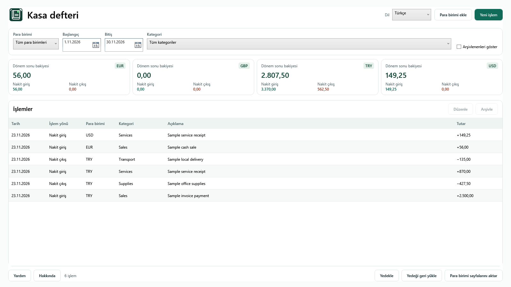

# AFRF Cashbook Lite

Free offline cash ledger for Windows 11 (x64). Record cash received and paid, see balances by currency, and export reports to Excel.

[Türkçe](#türkçe) · [Privacy policy](PRIVACY.md) · [Report a problem](https://github.com/afrfuniverse/afrf-cashbook-lite/issues/new/choose)

### What you can do

- Record receipts and payments and filter entries by date or category.
- Track balances by currency and export the filtered view to Excel.
- Archive and restore entries, and create a password-protected backup you can move to another PC.

The app works offline. It stores your ledger and daily backups locally in encrypted form after you grant permission. The Microsoft Store download link will be added here when the listing is available.

## Türkçe

AFRF Cashbook Lite, Windows 11 (x64) için ücretsiz ve çevrimdışı bir kasa defteridir. Nakit giriş ve çıkışlarını kaydedin, bakiyeleri para birimine göre izleyin ve raporları Excel’e aktarın.

- İşlemleri tarih veya kategoriye göre filtreleyin.
- Kayıtları arşivleyin, geri alın ve başka bir bilgisayara taşımak için parola korumalı bir yedek oluşturun.
- Onayınızın ardından kasa verileri ve günlük yedekler cihazınızda şifreli olarak saklanır.

Microsoft Store indirme bağlantısı, mağaza sayfası yayına girdiğinde burada paylaşılacak.

[Gizlilik politikası](PRIVACY.md#türkçe) · [Sorun bildir](https://github.com/afrfuniverse/afrf-cashbook-lite/issues/new/choose)
