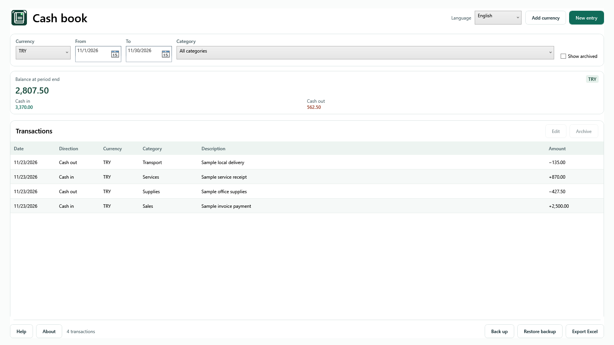

# AFRF Cashbook Lite

Free offline cash ledger for Windows 11 (x64). Record cash received and paid, see balances by currency, and export reports to Excel.

**[Install free from Microsoft Store](https://apps.microsoft.com/detail/9P256QR4DXKQ)** · [GitHub ZIP](#download-for-windows) · [Türkçe](#türkçe) · [Watch the quick demo](https://youtu.be/v4RI3hX917w)

[Privacy policy](PRIVACY.md) · [Report a problem](https://github.com/afrfuniverse/afrf-cashbook-lite/issues/new/choose)

## Download for Windows

### GitHub ZIP

**[Download Cashbook Lite 0.3.1 for Windows 11 x64](https://github.com/afrfuniverse/afrf-cashbook-lite/releases/download/v0.3.1/AFRF-Cashbook-Lite-0.3.1-win-x64.zip)** · [Release notes and SHA-256 checksum](https://github.com/afrfuniverse/afrf-cashbook-lite/releases/tag/v0.3.1)

Extract all files to a folder and open **AFRF.Cashbook.Lite.exe**. This build runs directly from that folder. The GitHub executable is unsigned.

## Screenshots

| Cash ledger · English | Currency balances · Türkçe |
| --- | --- |
|  |  |

### What you can do

- Record receipts and payments and filter entries by date or category.
- Track balances by currency and export the filtered view to Excel.
- Archive and restore entries, and create a password-protected backup you can move to another PC.

The app works offline. It stores your ledger and daily backups locally in encrypted form after you grant permission.

## Türkçe

AFRF Cashbook Lite, Windows 11 (x64) için ücretsiz ve çevrimdışı bir kasa defteridir. Nakit giriş ve çıkışlarını kaydedin, bakiyeleri para birimine göre izleyin ve raporları Excel’e aktarın.

**[Microsoft Store’dan ücretsiz yükleyin](https://apps.microsoft.com/detail/9P256QR4DXKQ)**.

**[Windows 11 x64 için Cashbook Lite 0.3.1’i indir](https://github.com/afrfuniverse/afrf-cashbook-lite/releases/download/v0.3.1/AFRF-Cashbook-Lite-0.3.1-win-x64.zip)**. Tüm dosyaları bir klasöre çıkarın ve **AFRF.Cashbook.Lite.exe** dosyasını açın. Uygulama kurulum gerektirmeden çalışır. GitHub sürümü dijital olarak imzalanmamıştır.

- İşlemleri tarih veya kategoriye göre filtreleyin.
- Kayıtları arşivleyin, geri alın ve başka bir bilgisayara taşımak için parola korumalı bir yedek oluşturun.
- Onayınızın ardından kasa verileri ve günlük yedekler cihazınızda şifreli olarak saklanır.

[Gizlilik politikası](PRIVACY.md#türkçe) · [Sorun bildir](https://github.com/afrfuniverse/afrf-cashbook-lite/issues/new/choose)
